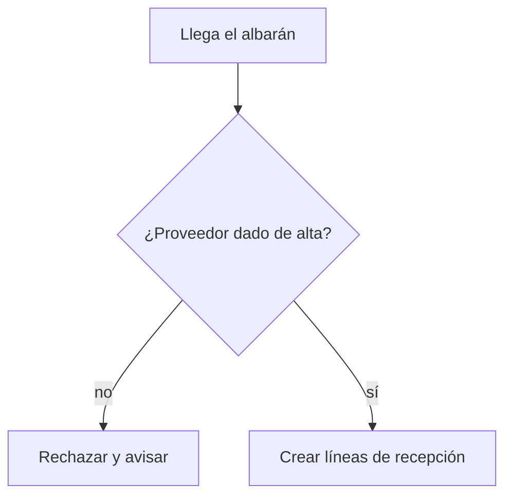

# Diagrama de flujo desde el código

Diagramar: $ARGUMENTS

## Qué es Mermaid

Mermaid es una forma de escribir diagramas como texto. Ese texto lo dibujan GitHub, GitLab,
VS Code (con la extensión «Markdown Preview Mermaid Support»), Obsidian y otros visores.
Al ser texto, se versiona con el código y se puede revisar en un diff.

## Proceso

### 1. Localizar el punto de entrada

Busca con Grep dónde empieza el proceso o la función indicada. Si hay varios candidatos,
enséñalos y pregunta cuál.

### 2. Seguir el flujo

- Sigue las llamadas desde el punto de entrada **hasta 3 niveles de profundidad**.
  Lo que quede más abajo se anota en «No incluido».
- Anota cada paso, cada decisión (if/switch) y cada salida, con su `fichero:línea`.
- Lee cada función antes de dibujarla. No deduzcas por el nombre.

### 3. Elegir el tipo de diagrama

- **`flowchart TD`** (flujo): un proceso con decisiones y ramas dentro de un mismo componente.
- **`sequenceDiagram`** (secuencia): varios componentes, servicios o la base de datos
  intercambiando llamadas.

Si el usuario lo indica en `$ARGUMENTS`, usa ese tipo.

### 4. Escribir el diagrama

Reglas para que Mermaid no falle al dibujarlo:

- IDs de nodo simples y numerados: `P1`, `P2`, `D1` (decisiones).
- Textos siempre entre comillas dobles: `P1["Leer albarán"]`.
- Nada de comillas dobles ni corchetes dentro de los textos.
- Decisiones con llaves y en forma de pregunta: `D1{"¿Ubicación con hueco?"}`.
- Etiquetas en las flechas: `D1 -->|"sí"| P3`.
- Máximo ~20 nodos. Si hay más, haz un diagrama general y otro de detalle por subproceso.
- Los textos en lenguaje de negocio, no nombres de funciones.

### 5. Guardar

Escribe `docs/diagramas/<slug>.md` con esta estructura:

````markdown
# <Proceso>



| Nodo | Qué pasa | Fuente |
|---|---|---|
| P1 | Entra un albarán por la interfaz de recepción | `src/recepcion/Entrada.java:40` |
| D1 | Se busca el proveedor en el maestro | `src/recepcion/Entrada.java:52-58` |

## No incluido
- <Llamadas por debajo del nivel 3 o ramas omitidas, con su fichero>
````

### 6. Resumen al usuario

- Ruta del fichero generado
- Tipo de diagrama y número de nodos
- Qué se ha dejado fuera
- Para verlo en el navegador: `/diagramas:mermaid docs/diagramas/<slug>.md` genera el visor

## Confidencialidad

El diagrama describe lógica de negocio. Ábrelo en visores locales o internos (VS Code, el
GitLab/GitHub de la empresa). No lo pegues en editores web públicos.
