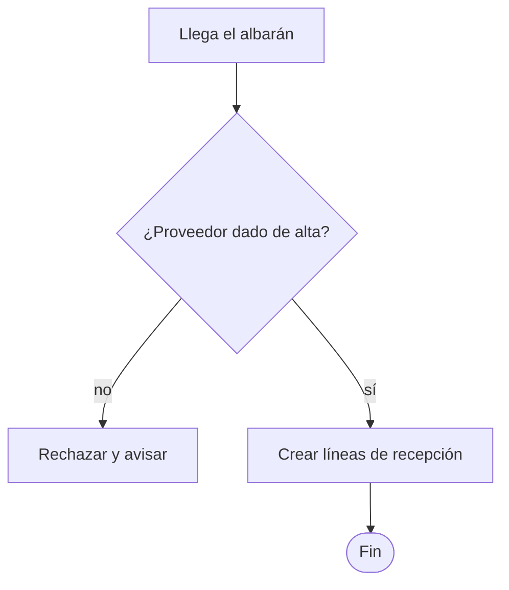
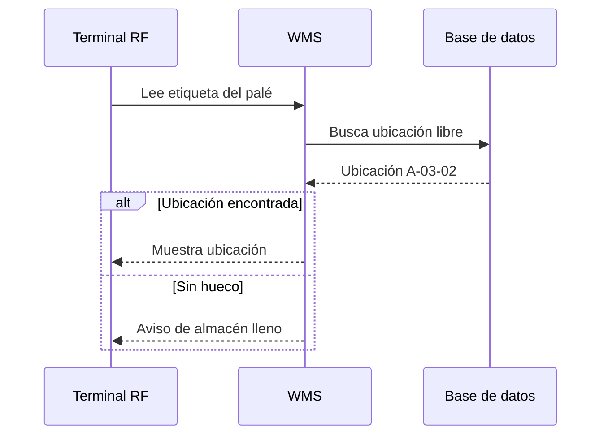
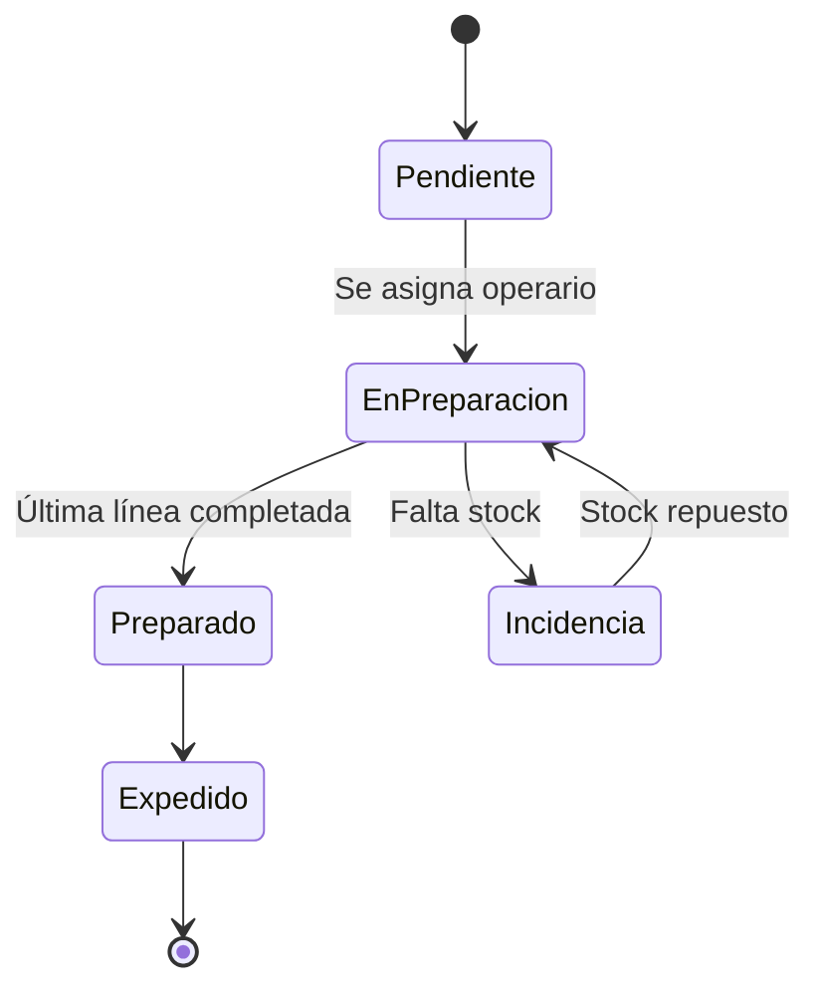
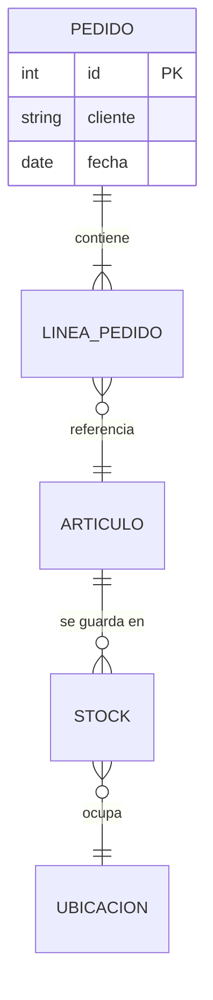
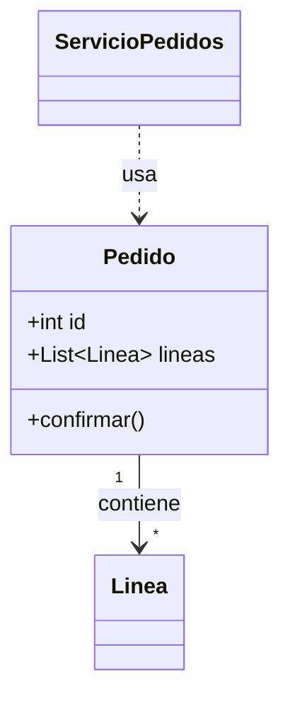

# Referencia rápida de Mermaid

## Flujo

- Dirección: `TD` (arriba-abajo) o `LR` (izquierda-derecha)
- Formas: `["rectángulo"]`, `{"decisión"}`, `(["inicio/fin"])`, `[("base de datos")]`
- Agrupar: `subgraph Recepcion["Recepción"] ... end`

## Secuencia

- `->>` llamada, `-->>` respuesta
- Bloques: `alt / else / end`, `opt ... end`, `loop ... end`
- Notas: `Note over WMS: texto`

## Estados

- Nombres de estado sin espacios; texto libre después de `:` en las transiciones

## Entidad-relación

- Cardinalidad: `||` uno, `o|` cero o uno, `}|` uno o más, `}o` cero o más

## Clases

- `-->` asociación, `..>` dependencia, `<|--` herencia, `*--` composición

## Errores frecuentes

- Comillas, corchetes o paréntesis dentro de un texto sin comillas → envolver en `"..."`
- La palabra `end` en minúsculas como texto de un nodo rompe el diagrama → `"Fin"` o `End`
- Tildes y eñes: funcionan dentro de comillas; en IDs, mejor evitarlas
